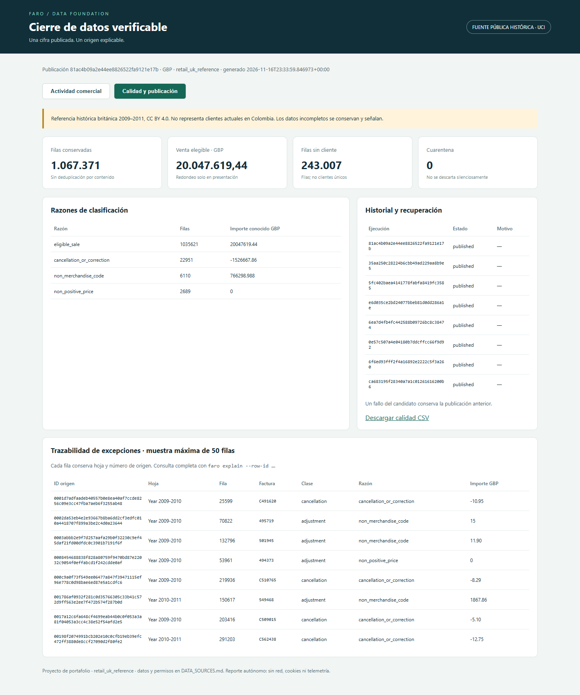

# Cierre de ventas

**Data Engineering** · Datos históricos · Reino Unido · [English](README.md) · [Portafolio de Jorge Alarcón](https://github.com/jorgealarcon07/jorgealarcon07/blob/main/README.es.md#proyectos)

   

## ¿Qué ventas podemos dar por cerradas?

Construí un proceso que separa ventas, cancelaciones y ajustes, comprueba los totales y avisa a finanzas cuando faltan datos. Finanzas puede consultar actividad con importes comprobados y ver qué parte carece de cliente. La falta de identificación limita los análisis por cliente. Los importes describen actividad comercial histórica en libras esterlinas.

**Resultado medido.** El cierre cuadró en 1.798 grupos de fecha y tipo de movimiento. De 1.067.371 filas, 243.007 carecían de cliente identificado, así que el informe quedó provisional.

[Abrir el informe en el navegador](https://jorgealarcon07.github.io/jorgealarcon07/cierre-de-ventas/) · [Leer el caso de estudio](CASO_DE_ESTUDIO.md) · [Ver la arquitectura](docs/ARQUITECTURA.md)

El informe permite cambiar a inglés desde el encabezado. Al ejecutar `faro report`, se generan `index.html` e `index.en.html` junto al mismo manifiesto y los mismos CSV.



## Cómo se construyó

Leí las dos hojas de Online Retail II, conservé cada fila en Parquet y usé SQL y dbt para clasificar los movimientos en PostgreSQL. Un segundo cálculo en Python vuelve a leer la fuente y comprueba conteos e importes antes de publicar. Una carga que falla deja disponible el cierre anterior.

[Resultados y conciliación](docs/RESULTADOS.md) · [Prueba de recuperación](docs/INCIDENTE_SIMULADO.md) · [Datos y licencia](DATA_SOURCES.md)

## Qué se puede revisar

- [Caso de estudio](CASO_DE_ESTUDIO.md), [resultados medidos](docs/RESULTADOS.md) y [aceptación JSON](reports/acceptance.json).
- [Arquitectura y decisiones](docs/ARQUITECTURA.md), [diccionario](docs/DICCIONARIO.md), [fuentes y licencia](DATA_SOURCES.md).
- [Reporte real guardado](reports/published/retail_uk_reference/index.html): abrir localmente en navegador; [demo sintética](reports/published/retail_synthetic/index.html).
- [Pruebas verificadas](reports/tests.xml), [escenarios de recuperación](docs/INCIDENTE_SIMULADO.md), [cumplimiento de estándares](docs/CUMPLIMIENTO.md).
- [Proyecto Power BI editable](bi/Faro.pbip), [instrucciones BI](bi/README.md), [recursos para la futura web](assets/web/README.md).

Se procesaron las **1.067.371 filas de ambas hojas** de UCI. Rebuild, replay y backfill producen el mismo SHA-256 de datos. El consumidor muestra `provisional` por filas sin identificador de cliente: no se fabricaron valores para obtener un estado verde.

## Requisitos

Python **3.12**, Git y PostgreSQL **17**. Se verificó en Windows 11 con PostgreSQL 17.12 nativo. Docker Compose es una ruta alternativa configurada; su ejecución y Airflow requieren Linux containers/WSL2 y no se comprobaron en este host. Power BI Desktop es opcional para consumir: HTML/CSV/JSON funcionan sin él.

En Windows conviene clonar en una ruta corta y crear el entorno en una ruta corta: pip puede exceder el límite de rutas de Windows al instalar dbt.

```powershell
# Desde el repositorio, con Python 3.12 disponible:
python -m venv .venv
.venv/Scripts/python -m pip install -r requirements.lock
.venv/Scripts/python -m pip install --no-deps --no-build-isolation -e .
.venv/Scripts/python -m pip check
# Activación opcional para usar luego los comandos python/faro directamente:
.venv/Scripts/Activate.ps1
```

En macOS/Linux: usar `.venv/bin/python` y PostgreSQL local o Compose. Si PowerShell no permite activar scripts, usar `.venv/Scripts/python` en cada comando y `python -m faro_foundation.cli` en lugar de `faro`, sin cambiar políticas globales. `requirements.lock` fija también dependencias de desarrollo; no asumir que un venv creado con otra versión de Python es equivalente. Primera instalación requiere red. Datos sintéticos y reporte estático pueden ejecutarse sin red después de instalar dependencias.

## Demo nativa en Windows

Si ya tienes PostgreSQL 17, configura las variables de `.env.example` en un `.env` con contraseña propia y crea la base `faro`. Nunca versionar ese archivo. Para un laboratorio aislado sin instalador:

```powershell
python scripts/fetch_postgres.py
python scripts/native_postgres.py start --bin .runtime/postgres/bin
python scripts/verify_native.py --bin .runtime/postgres/bin
```

Usa el Python del venv en esos comandos. `fetch_postgres.py` descarga binarios de desarrollo de Zonky/Maven Central con hash fijado; ver [procedencia](docs/ARQUITECTURA.md). `native_postgres.py` crea solo un cluster del proyecto y genera contraseña aleatoria en `.env`. No instala servicios ni cambia PostgreSQL ajeno.

`verify_native.py` ejecuta servidor y clientes en la misma sesión, pasa toda la suite y ejecuta la demo de 10.000 filas. Es la ruta verificada para el sandbox de Windows, donde una conexión desde otra invocación de herramienta puede expirar. Detiene únicamente su cluster al terminar, conservando datos. Fuera del sandbox, con un servidor accesible, basta:

```powershell
faro demo
faro validate --namespace retail_synthetic
faro report --namespace retail_synthetic
```

La demo verifica publicación inicial → caída simulada antes de publicar → preservación del head → reanudación del mismo run → backfill. Comprueba igualdad de hashes automáticamente. Abre `reports/latest/retail_synthetic/index.html`; no requiere servidor HTTP.

## Ejecución real completa

```powershell
# Ruta acotada, con el cluster del proyecto ya inicializado:
python scripts/verify_native.py --bin .runtime/postgres/bin --full

# Con PostgreSQL accesible de forma persistente:
faro download
faro run --input data/downloads/online_retail_II.xlsx --kind public_real_historical
faro validate --namespace retail_uk_reference
faro report --namespace retail_uk_reference
faro run --input data/downloads/online_retail_II.xlsx --kind public_real_historical --start 2010-12-01 --end 2010-12-08
```

El intervalo es `[inicio, fin)`. Un backfill requiere una publicación previa de la misma versión de fuente. Las filas fuera del intervalo permanecen; las de fecha inválida requieren rebuild para corregirse. Un checksum no aprobado bloquea antes de cargar. No hay deduplicación por contenido.

```powershell
faro run --resume <run_id>
faro explain --namespace retail_uk_reference --row-id <source_row_id>
```

El run publicado se conserva; reanudar uno ya publicado es idempotente. Si otro run publicó entretanto, se rechaza un head obsoleto: crear un nuevo run, no forzar el anterior. [Recuperación y retención](docs/RUNBOOK.md).

## Docker Compose y Airflow

```powershell
# Crear .env con FARO_DB_PASSWORD=<contraseña propia>; no copiar credenciales de CI.
docker compose up -d postgres
docker compose run --rm app demo
docker compose run --rm app download
docker compose run --rm app run --input data/downloads/online_retail_II.xlsx --kind public_real_historical
docker compose --profile airflow up -d airflow
```

Airflow: `http://127.0.0.1:8080`; las credenciales de desarrollo las genera `standalone`. Ejecutar `faro_data_close` con configuración `input_file`, `data_kind` y, opcionalmente, `start/end`. Sin intervalo hace rebuild completo. Cinco tareas y retries ejecutan las mismas funciones verificadas por la ruta nativa. Es una configuración de laboratorio, sin garantía de seguridad productiva. No se afirma una ejecución Airflow en este host.

En Linux, ajustar permisos de bind mounts para el usuario del contenedor antes de iniciar; no usar `chmod 777`. Ver detalles en [runbook](docs/RUNBOOK.md). `docker compose stop` detiene sin borrar datos. Nunca usar `down -v` si se quieren conservar snapshots.

## Comprobaciones

```powershell
python -m ruff check .
python scripts/check_contracts.py
python -m pytest -m 'not integration and not airflow'
python -m pytest -m 'not airflow' --junitxml=reports/tests.xml
python scripts/check_secrets.py
python bi/validate_powerbi.py
```

Las pruebas de integración requieren PostgreSQL accesible; no se omiten silenciosamente si falta. La ruta `verify_native.py` evita la separación de sesiones del sandbox. El CI de GitHub añade un servicio PostgreSQL y un smoke de importación del DAG en Linux; su estado se puede consultar en la pestaña Actions del repositorio. La validación BI consulta esquemas Microsoft y necesita red; no equivale a abrir/refrescar Desktop.

## Alcance y límites

No hay pagos, costos, vencimientos o zona horaria de negocio confirmada. El importe firmado no es caja ni ingreso reconocido. Datos de 2009–2011 no validan un negocio actual en Colombia. No se infiere ahorro por automatización. La clasificación de códigos es una regla conservadora revisable. El backfill conserva un snapshot completo y paga ese costo de disco; no demuestra procesamiento distribuido.

La parte central está implementada y ejecutada con datos reales. Las verificaciones pendientes por entorno son el contenedor, el scheduler Airflow y Power BI Desktop; las alternativas nativas y HTML están probadas. AWS y Spark son ampliaciones opcionales de la especificación y no se implementaron. No se desarrolló el proyecto 02.
