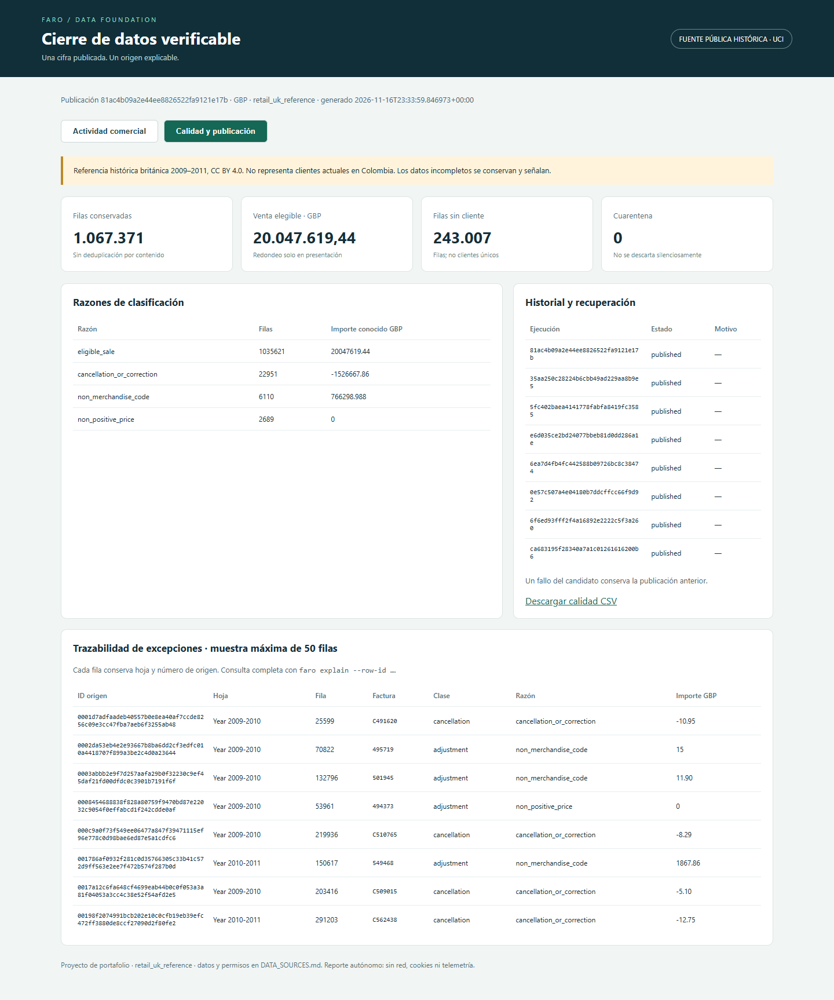

# Sales close

**Data Engineering** · Historical retail data from the United Kingdom · [Español](README.es.md) · [Portfolio](https://github.com/jorgealarcon07#projects)

   

## Which sales figures are ready to use?

I built a sales close for a fictional finance team. It classifies sales, cancellations and adjustments, checks totals against the original file and shows where data gaps limit analysis. A failed run leaves the last usable report available.

**Measured result.** The pipeline processed 1,067,371 rows and matched an independent calculation across 1,798 groups by date and transaction type. It published the close as provisional because 243,007 rows lacked a customer ID.

[Case study](CASE_STUDY.md) · [Open interactive report (Spanish)](https://jorgealarcon07.github.io/jorgealarcon07/cierre-de-ventas/) · [Architecture (Spanish)](docs/ARQUITECTURA.md)



## How it works

Python preserves source row identity and stages the records in Parquet. PostgreSQL and dbt classify and aggregate them. A separate Python calculation using exact decimal arithmetic reads the original workbook and checks counts and amounts. Publication switches report consumers to the new snapshot in a single transaction once the checks pass.

[Results and test conditions (Spanish)](docs/RESULTADOS.md) · [Acceptance evidence](reports/acceptance.json) · [Data and licensing notes (Spanish)](DATA_SOURCES.md) · [CI runs](https://github.com/jorgealarcon07/faro-data-foundation/actions)

## Run the synthetic demo

Use Python 3.12 and a dedicated PostgreSQL 17 instance. Create the `faro` database and configure the connection with [.env.example](.env.example) as a reference. Run from the repository root. The commands use PowerShell. On Linux or macOS, use `. .venv/bin/activate`.

```powershell
python -m venv .venv
.\.venv\Scripts\Activate.ps1
python -m pip install -r requirements.lock
python -m pip install --no-deps --no-build-isolation -e .
python -m pip check
faro demo
faro validate --namespace retail_synthetic
faro report --namespace retail_synthetic
```

Open `reports/latest/retail_synthetic/index.html`. See the [full guide in Spanish](README.es.md) for a Windows runner with an isolated database, the historical rebuild and backfills.
