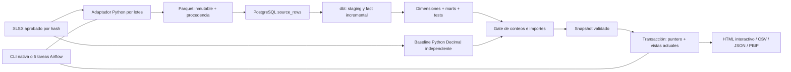

# Arquitectura y decisiones

## Responsabilidades

`source.py` valida procedencia y convierte XLSX a Parquet por lotes. `baseline.py` vuelve a leer el libro y clasifica/agrega con Python Decimal, sin consultar resultados dbt. `store.py` encapsula SQL operacional, COPY, locks y publicación. `pipeline.py` coordina la ejecución y gates. `workflow.py` expone las mismas operaciones en cinco fases para Airflow. `report.py` solo consume la publicación vigente. `cli.py` configura entradas y comandos; no implementa reglas de clasificación.

No hay clases base abstractas sin dos implementaciones reales. La configuración inmutable y funciones con entradas explícitas aplican responsabilidad única y facilitan pruebas. Las reglas SQL y el baseline independiente se parecen por necesidad semántica, pero no comparten la función clasificadora; así, un error de traducción puede detectarse.

## Persistencia y grano

`faro.sources`: una versión de fuente. `faro.source_rows`: una fila por checksum + identidad de origen; PK impide duplicación de identidad, no de contenido. `faro.runs/events`: estado y bitácora. Cada ejecución usa un esquema `r_<uuidhex>` para candidato; ningún nombre arbitrario del usuario se interpola como SQL. El snapshot incluye una fila fact por origen, dimensiones sin SCD ficticio y dos marts por día/clase y día/calidad.

`faro.publications` elige el snapshot vigente por namespace. Las seis vistas `faro.current_*` se reemplazan en la misma transacción que el puntero; no exponen tablas candidatas parcialmente escritas. Los lectores pueden mantener su consulta anterior durante un cambio. Un lock de publicación y comparación optimista del head impiden que una ejecución vieja sobrescriba una más reciente. El mismo run tiene lock de sesión para serializar retries de la CLI.

## ADR-001 — PostgreSQL real y alternativa nativa

Docker/WSL no estaban disponibles en este host. Se ejecutó PostgreSQL 17.12 nativo, aislado y sin servicio del sistema. Los binarios provinieron del empaquetado [Zonky](https://github.com/zonkyio/embedded-postgres-binaries) en Maven Central después de fallar DNS de EDB; checksum del JAR en `reports/runtime.json`. No se sustituyó el motor por SQLite. En el sandbox, servidor y clientes necesitan la misma invocación; `scripts/verify_native.py` reproduce esa validación y detiene el servidor al terminar.

## ADR-002 — Snapshot completo y backfill acotado

Cada publicación es un snapshot materializado para que el consumidor siempre vea una versión consistente. Un backfill exige una publicación previa de la **misma fuente**; clona su fact en candidato, elimina exclusivamente `[start,end)` allí y dbt incremental reconstruye esas filas. Las dimensiones/marts se recalculan sobre el snapshot resultante. Filas sin fecha se conservan del snapshot previo; su corrección requiere rebuild completo. No se presume un CDC inexistente.

Se paga una copia completa y más disco para simplificar recuperación a este volumen. No es un warehouse de escala ilimitada ni una estrategia de almacenamiento incremental eficiente. La mejora de tiempo se mide, no se presupone. Otra versión de archivo requiere rebuild, pues reordenar Excel cambia la identidad de fila.

## ADR-003 — Autoridad monetaria y consumidor

Decimal/NUMERIC son la referencia de integridad. Los floats del lector XLSX se convierten por su representación decimal; se preserva el original en archivo y campos de texto. Valores no finitos, magnitud >10^15 o precisión fuera del contrato son desconocidos explícitos, no ceros. Las reglas y límites están en el diccionario. El HTML/Power BI redondea para visualización; el CSV/SQL conserva la cifra de referencia. No son caja ni ingresos reconocidos.

HTML autónomo permite revisar sin licencias o servidor; filtra clases, cambia de vista y enlaza a exports. Power BI se entrega editable PBIP/PBIR con importación de esos CSV y medidas DAX. Sus esquemas y bindings se validaron; no se afirma haber abierto/refrescado Desktop. No se genera un PBIX falso ni un binario sin validar.

## ADR-004 — Orquestación

Airflow ejecuta prepare→load→build→validate→publish con reintentos y entradas por entorno, sin interpolar configuración en comandos shell. No procesa datos al importar el DAG, no lleva datos grandes ni secretos a XCom y limita runs activos a uno. `schedule=None` es intencional: se reproducen intervalos históricos mediante parámetros, no se finge un feed vivo. La CLI nativa ejecuta el mismo núcleo y fue verificada; la imagen Airflow requiere Linux y su smoke queda automatizado en CI.

## Seguridad y alcance

Escucha local, secretos ignorados, SQL parametrizado, identificadores validados, JSON/DOM seguro y originales fuera de Git. El usuario `faro` del laboratorio administra su base; no es una configuración de privilegios mínimos para producción. No hay TLS ni autenticación de un portal público porque el consumidor es un archivo local. Antes de exposición externa se necesitarían roles separados, TLS, autenticación, backups externos y supervisión operativa.
